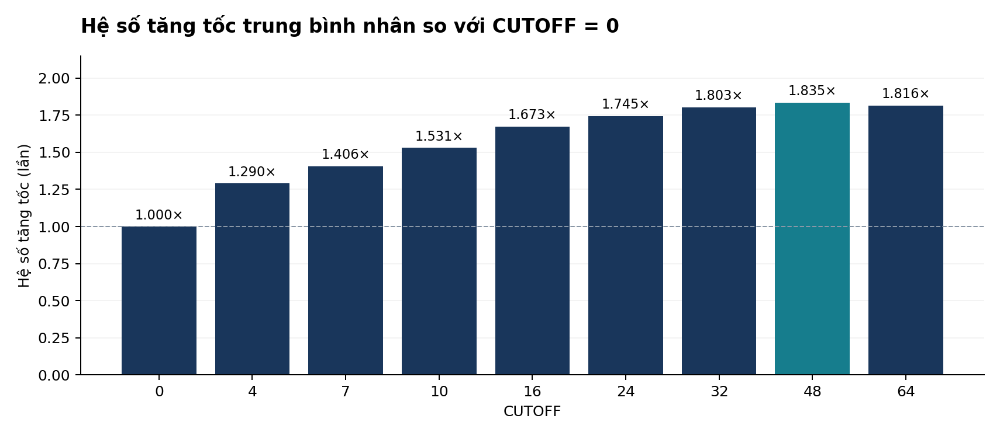
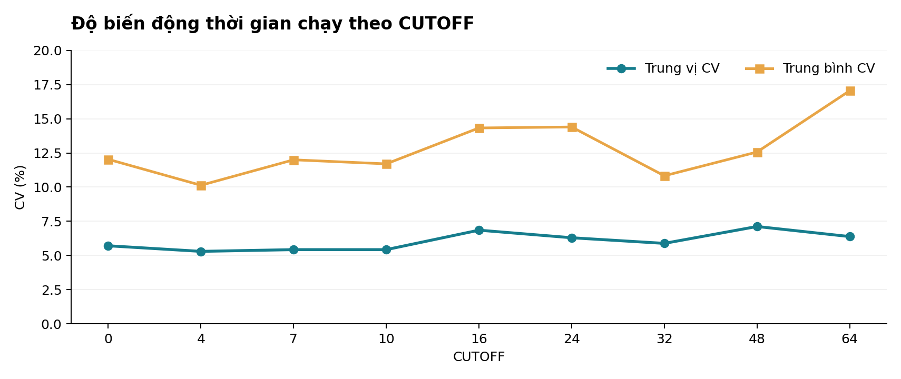
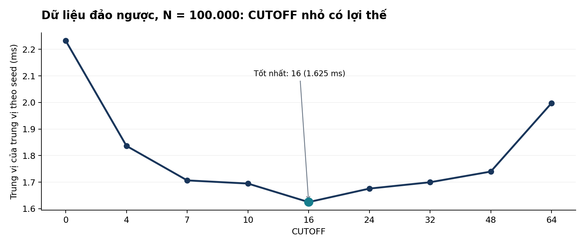

# BÁO CÁO THỰC NGHIỆM ENHANCED MERGESORT

**Phần:** Thống kê kết quả và đánh giá độ ổn định của thí nghiệm  
**Ngôn ngữ:** Java 19  
**Nguồn dữ liệu:** `results/summary_results.csv`, `results/best_cutoff.csv`  
**Người thực hiện:** ................................................  
**Ngày thực hiện:** 16/11/2026  

> **Tóm tắt:** Trên 54 bộ dữ liệu và 9 CUTOFF, CUTOFF **48** đạt hệ số tăng tốc trung bình nhân cao nhất (**1,835×**), trong khi **64** dẫn đầu **9/18** nhóm loại dữ liệu–kích thước. Mức hơn kém giữa 48 và 64 chỉ khoảng **1,06%** về hệ số tăng tốc tổng hợp, chưa đủ để khẳng định ưu thế có ý nghĩa thống kê.

## 1. Thiết kế và phương pháp thống kê

### 1.1. Cấu hình thí nghiệm

- 6 dạng đầu vào: Random, Sorted, Reversed, Nearly Sorted, Many Duplicates, All Equal.
- Kích thước `N`: 1.000, 10.000, 100.000.
- Seed cố định: 42, 2026, 123456.
- CUTOFF: 0, 4, 7, 10, 16, 24, 32, 48, 64.
- Mỗi cấu hình có 20 lần đo; thời gian biểu diễn bằng mili giây (ms).
- Benchmark dùng `System.nanoTime()`, warm-up và đo thời gian hàm `EnhanceMergesort.sort(a, cutoff)`; định nghĩa giao thức này được mô tả bởi chương trình, còn hai CSV không xác thực được số lượt warm-up hoặc thứ tự chạy.

| Kiểm tra dữ liệu | Kết quả |
|---|---:|
| Nhóm theo (loại dữ liệu, N) | 18 |
| Bộ dữ liệu theo (loại, N, seed) | 54 |
| Cấu hình theo (loại, N, seed, CUTOFF) | 486 |
| Số mẫu đo trên mỗi cấu hình | 20 |
| Tổng lượt đo được thống kê | 9.720 |
| Thiếu dữ liệu / trùng khóa cấu hình | 0 |

### 1.2. Công thức và cách diễn giải

- **Mean**: trung bình 20 lần đo, phản ánh thời gian trung bình nhưng nhạy với các lượt chậm đột biến.
- **Median**: trung vị 20 thời gian chạy, ít nhạy hơn với ngoại lệ.
- **Standard deviation (s)**: độ phân tán của thời gian đo quanh mean.
- **CV (%)** = `100 × standard deviation / mean`: độ phân tán tương đối; CV không thay thế việc xem phân phối đo.
- **Min/Max**: giá trị nhỏ nhất và lớn nhất; dùng để nhận diện khoảng dao động.
- **Speedup(c)** = `median(CUTOFF=0) / median(CUTOFF=c)` cho từng bộ dữ liệu.
- **G(c)** = `exp(mean(ln(speedup_i(c))))` trên 54 bộ dữ liệu; dùng trung bình nhân để không cho dữ liệu có thời gian lớn lấn át bằng phép cộng ms.
- Để tổng hợp theo từng nhóm loại dữ liệu và N, báo cáo dùng **trung vị của ba median theo seed**; đây là chỉ số mô tả, không phải median gộp của 60 lượt đo.

## 2. Kết quả thời gian theo CUTOFF

Ba bảng dưới tổng hợp 3 seed cho mỗi nhóm. **Số liệu là thời gian trung vị của ba median theo seed (ms)**.

### 2.1. Kích thước N = 1.000

| Dữ liệu | 0 | 4 | 7 | 10 | 16 | 24 | 32 | 48 | 64 |
|---|---:|---:|---:|---:|---:|---:|---:|---:|---:|
| Random | 0,05035 | 0,03615 | 0,03535 | 0,03160 | 0,02405 | 0,02465 | 0,02265 | **0,02125** | 0,02615 |
| Sorted | 0,01715 | 0,01090 | 0,01050 | 0,00850 | 0,00710 | 0,00710 | 0,00615 | 0,00605 | **0,00490** |
| Reversed | 0,01665 | 0,01160 | 0,01140 | 0,01005 | 0,00955 | **0,00950** | 0,01095 | 0,01090 | 0,01620 |
| Nearly Sorted | 0,01675 | 0,01100 | 0,01050 | 0,00895 | 0,00760 | 0,00760 | 0,00650 | 0,00660 | **0,00570** |
| Many Duplicates | 0,03045 | 0,02000 | 0,01885 | 0,01870 | 0,01400 | 0,01400 | 0,01315 | **0,01305** | 0,01795 |
| All Equal | 0,01560 | 0,01010 | 0,00975 | 0,00780 | 0,00665 | 0,00660 | 0,00560 | 0,00565 | **0,00450** |

### 2.2. Kích thước N = 10.000

| Dữ liệu | 0 | 4 | 7 | 10 | 16 | 24 | 32 | 48 | 64 |
|---|---:|---:|---:|---:|---:|---:|---:|---:|---:|
| Random | 0,69045 | 0,62730 | 0,58395 | 0,53915 | 0,54120 | 0,50530 | 0,50610 | 0,48375 | **0,48320** |
| Sorted | 0,18920 | 0,14780 | 0,12560 | 0,10910 | 0,10910 | 0,09235 | 0,09235 | **0,08545** | 0,08550 |
| Reversed | 0,18705 | 0,15405 | 0,13755 | 0,12665 | 0,12760 | 0,12595 | **0,12475** | 0,15125 | 0,15160 |
| Nearly Sorted | 0,21335 | 0,17515 | 0,14865 | 0,13120 | 0,12955 | 0,11505 | 0,11575 | **0,10375** | 0,10450 |
| Many Duplicates | 0,44175 | 0,38760 | 0,35265 | 0,31175 | 0,31065 | 0,27885 | 0,28150 | **0,25675** | 0,26010 |
| All Equal | 0,17515 | 0,13710 | 0,11770 | 0,10105 | 0,10190 | 0,08615 | 0,08805 | **0,07965** | 0,07995 |

### 2.3. Kích thước N = 100.000

| Dữ liệu | 0 | 4 | 7 | 10 | 16 | 24 | 32 | 48 | 64 |
|---|---:|---:|---:|---:|---:|---:|---:|---:|---:|
| Random | 7,71770 | 7,05805 | 6,72970 | 6,63970 | 6,32705 | 6,29725 | 6,11090 | 6,18270 | **5,90105** |
| Sorted | 2,15145 | 1,68195 | 1,48800 | 1,46805 | 1,30870 | 1,24330 | 1,20635 | 1,18845 | **1,11125** |
| Reversed | 2,23205 | 1,83645 | 1,70670 | 1,69480 | **1,62500** | 1,67580 | 1,69970 | 1,73985 | 1,99730 |
| Nearly Sorted | 2,42080 | 2,00090 | 1,83240 | 1,79590 | 1,60445 | 1,54475 | 1,51195 | 1,45865 | **1,35470** |
| Many Duplicates | 4,59755 | 4,03550 | 3,69150 | 3,69860 | 3,38045 | 3,16325 | 3,04630 | 2,96820 | **2,84825** |
| All Equal | 2,01410 | 1,56815 | 1,38470 | 1,37075 | 1,21105 | 1,16805 | 1,13405 | 1,11385 | **1,04185** |

**Nhận xét:** CUTOFF 48–64 thường nhanh nhất trên dữ liệu Random, Sorted, Nearly Sorted, Many Duplicates, All Equal; riêng Reversed lần lượt chọn CUTOFF 24, 32, 16 khi N tăng.

### 2.4. Số lần đứng đầu và mức độ sát nhau

| CUTOFF | Số nhóm đứng đầu / 18 |
|---|---:|
| 64 | 9 |
| 48 | 6 |
| 32 | 1 |
| 24 | 1 |
| 16 | 1 |

Ở **8/18 nhóm**, khoảng cách giữa CUTOFF tốt nhất và phương án đứng thứ hai dưới 2%. Vị trí dẫn đầu do đó không tự chứng minh khác biệt đáng kể.

### 2.5. Tăng tốc tổng hợp

| CUTOFF | Speedup trung bình nhân | Mức giảm thời gian quy đổi* |
|---|---:|---:|
| 0 | 1,000× | 0,00% |
| 4 | 1,290× | 22,48% |
| 7 | 1,406× | 28,86% |
| 10 | 1,531× | 34,67% |
| 16 | 1,673× | 40,24% |
| 24 | 1,745× | 42,71% |
| 32 | 1,803× | 44,55% |
| 48 | 1,835× | 45,50% |
| 64 | 1,816× | 44,92% |

*Phần trăm được quy đổi từ hệ số tăng tốc tổng hợp theo `100 × (1 - 1/G)`; không phải trung bình số học của phần trăm tiết kiệm thời gian.

**Hình 1.** Hệ số tăng tốc trung bình nhân theo CUTOFF (54 bộ dữ liệu).

## 3. Đánh giá độ ổn định

### 3.1. Độ biến động theo CUTOFF

| CUTOFF | Trung vị CV (%) | Trung bình CV (%) | Số cấu hình CV > 20% / 54 |
|---|---:|---:|---:|
| 0 | 5,71 | 12,03 | 9 |
| 4 | 5,30 | 10,13 | 7 |
| 7 | 5,42 | 12,00 | 7 |
| 10 | 5,42 | 11,70 | 7 |
| 16 | 6,85 | 14,33 | 11 |
| 24 | 6,29 | 14,40 | 9 |
| 32 | 5,88 | 10,83 | 7 |
| 48 | 7,12 | 12,57 | 10 |
| 64 | 6,38 | 17,05 | 10 |

CUTOFF 4 có trung vị CV thấp nhất nhưng không tối ưu về tốc độ. CUTOFF 32 cân bằng tốt hơn (speedup 1,803×; trung bình CV 10,83%). Với 48 và 64, trung vị CV của 64 thấp hơn nhưng CV trung bình lại cao hơn — vì vậy không thể kết luận một phương án luôn ổn định hơn.

**Hình 2.** So sánh trung vị CV và trung bình CV theo CUTOFF.

### 3.2. Độ biến động theo kiểu dữ liệu và kích thước

| Loại dữ liệu | Trung vị CV (%) | Trung bình CV (%) |
|---|---:|---:|
| Random | 5,24 | 11,51 |
| Sorted | 9,00 | 17,26 |
| Reversed | 7,61 | 20,03 |
| Nearly Sorted | 5,13 | 8,59 |
| Many Duplicates | 8,06 | 9,25 |
| All Equal | 4,28 | 10,06 |

| N | Trung vị CV (%) |
|---|---:|
| 1.000 | 7.59 |
| 10.000 | 5.79 |
| 100.000 | 5.26 |

Với N = 1.000, trung vị CV 7,59% (cao hơn ở N = 10.000 và N = 100.000). Phép đo chỉ kéo dài vài micro giây có thể rất nhạy với nhiễu tương đối. Dữ liệu Reversed có trung bình CV 20,03% do một số cấu hình có ngoại lệ lớn.

### 3.3. Các trường hợp thời gian bất thường

| Dữ liệu | N | Seed | CUTOFF | Mean (ms) | Median (ms) | CV (%) | Max (ms) |
|---|---:|---:|---:|---:|---:|---:|---:|
| All Equal | 1000 | 2026 | 24 | 0,01342 | 0,00660 | 221,32 | 0,13960 |
| Reversed | 100000 | 2026 | 64 | 3,89321 | 2,05765 | 166,31 | 31,23710 |
| Nearly Sorted | 1000 | 2026 | 64 | 0,00995 | 0,00625 | 156,73 | 0,07600 |
| Reversed | 100000 | 2026 | 7 | 3,21998 | 1,74185 | 152,04 | 23,01620 |
| Sorted | 100000 | 42 | 10 | 2,52868 | 1,50580 | 135,67 | 16,77700 |

Ví dụ, Reversed N = 100.000, seed 2026, CUTOFF 64 có median **2,05765 ms** nhưng max **31,23710 ms**, lớn hơn median khoảng 15,2 lần. Một hoặc nhiều lượt đo rất chậm có thể khiến mean cao hơn median. Chưa thể xác định số lượng hay nguyên nhân các lượt bất thường từ hai tệp tổng hợp.

### 3.4. Khác biệt theo seed

| Random, N = 1.000, CUTOFF = 48 | Median (ms) |
|---|---:|
| Seed 42 | 0,06730 |
| Seed 2026 | 0,02125 |
| Seed 123456 | 0,02115 |

Seed 42 có thời gian khoảng 3,18 lần so với seed 123456. Đây có thể là hiệu ứng dữ liệu, thứ tự thực thi hoặc trạng thái JVM; chỉ số tổng hợp hiện tại không xác định được nguyên nhân.

## 4. Thảo luận: CUTOFF 48, 64 và dữ liệu đảo ngược

- **48** đạt speedup tổng hợp **1,835×**; **64** đạt **1,816×**. Khoảng cách của hai hệ số tăng tốc xấp xỉ **1,06%**.
- Xét 54 bộ dữ liệu: 48 có median nhanh hơn ở **22** trường hợp; 64 nhanh hơn ở **31** trường hợp; **1** trường hợp bằng nhau. Số lần thắng và mức thắng là hai tiêu chí khác nhau.
- Đối với **Reversed, N = 100.000**, CUTOFF 16 có median tổng hợp **1,62500 ms**, còn 64 là **1,99730 ms**, nghĩa là 64 chậm hơn **22,91%** theo tỷ số thời gian.

**Hình 3.** Thời gian theo CUTOFF đối với mảng Reversed, N = 100.000.

**Giả thuyết cơ chế:** Dừng phân chia sớm làm tăng kích thước đoạn giao cho Insertion Sort. Với đoạn đảo ngược, Insertion Sort có nhiều phép dịch chuyển và so sánh, có thể đạt O(k²). Khi CUTOFF quá lớn, phần tăng chi phí này có thể vượt lợi ích từ việc giảm đệ quy/merge. Đây là giải thích cơ chế hợp lý nhưng chưa chứng minh quan hệ nhân quả từ dữ liệu thời gian.

## 5. Hạn chế, sai số và khả năng tái lập

- JIT compilation, Garbage Collection, scaling tần số CPU, cache, scheduler và các tiến trình nền đều có thể làm sai lệch thời gian; chưa có log đủ để quy lỗi cụ thể.
- 20 lượt đo trong cùng JVM không tương đương 20 phiên thí nghiệm độc lập.
- Ba seed của nhóm **All Equal** cho cùng mảng gồm toàn số 7, không phải ba mẫu nội dung độc lập.
- Chưa đo CUTOFF > 64; không có cơ sở tuyên bố 48/64 là tối ưu toàn cục.
- Chưa có `raw_results.csv`: không kiểm tra được thứ tự lượt chạy, phân phối gốc, IQR, ngoại lệ theo phiên hoặc khoảng tin cậy phù hợp.
- Chênh lệch 48–64 nhỏ và chưa có kiểm định thống kê hoặc phiên đo độc lập xác nhận.

## 6. Kết luận và hướng mở rộng

**Trong phạm vi thí nghiệm hiện tại**, chọn **CUTOFF 48** làm ứng viên mặc định theo tiêu chí tăng tốc trung bình nhân (1,835× so với 0). CUTOFF **64** là đối thủ gần tương đương, dẫn đầu 9/18 nhóm. Nếu nhấn mạnh cân bằng hiệu năng và CV bình quân, **32** là phương án đáng cân nhắc. Đối với dữ liệu đảo ngược lớn, **16** đạt kết quả tốt hơn trong dải giá trị đã đo.

Nên lặp lại benchmark thành các phiên JVM độc lập, đối chiếu 32/48/64 và các giá trị 80/96/128, bổ sung `raw_results.csv`, theo dõi GC và tải hệ thống. Nên giải thích rõ thuật toán MergeSort là phần tự cài đặt, còn AI hỗ trợ sinh dữ liệu, benchmark và thống kê.

## 7. Nguồn dữ liệu & cách tái lập

Các con số trong báo cáo được tính trực tiếp từ:

- [`results/summary_results.csv`](../results/summary_results.csv) — 486 cấu hình với mean, median, stddev, min, max, speedup.
- [`results/best_cutoff.csv`](../results/best_cutoff.csv) — 18 nhóm theo loại dữ liệu và kích thước.

Để tái lập trên máy khác: chạy lại `GenerateTestData.java` để tạo `data/`, chạy `Benchmark.java` với `EnhanceMergesort.java` do người thực hiện tự viết, sau đó so sánh CSV mới; thời gian có thể khác theo CPU, JVM và môi trường.

---

*Bản báo cáo này là phân tích dữ liệu tổng hợp, không phải chứng nhận kiểm định ý nghĩa thống kê hay kết quả benchmark trên một máy khác.*
Môi trường và cấu hình thực nghiệm

Thí nghiệm tìm giá trị CUTOFF tối ưu cho thuật toán Enhanced MergeSort được thực hiện trên máy tính cá nhân có bộ xử lý Intel Core i5-12500H thế hệ 12, bộ nhớ RAM khoảng 16 GB và hệ điều hành Microsoft Windows 11 Pro (phiên bản 10.0.22631).

Chương trình được phát triển bằng Java, sử dụng JDK 19.0.1, trình biên dịch javac 19.0.1 và Java HotSpot 64-Bit Server VM (build 19.0.1+10-21). Thời gian thực thi được đo bằng phương thức System.nanoTime().

Thí nghiệm sử dụng 6 loại dữ liệu, 3 kích thước mảng, 3 seed cố định và 9 giá trị CUTOFF. Mỗi cấu hình được thực hiện 5 lượt warm-up và 20 lượt đo chính thức.

Thời gian đọc dữ liệu từ file, sao chép mảng và kiểm tra kết quả sắp xếp được loại khỏi khoảng thời gian đo thuật toán.

Việc cố định dữ liệu đầu vào, seed và phương pháp đo giúp nâng cao khả năng tái lập thí nghiệm. Tuy nhiên, kết quả vẫn có thể chịu ảnh hưởng của JIT compilation, garbage collection, bộ nhớ đệm, nhiệt độ CPU và tải hệ thống.

Các điều kiện như chế độ nguồn điện, nhiệt độ CPU và mức sử dụng tài nguyên trong thời điểm đo ban đầu không được ghi nhận đầy đủ. Do đó, nghiên cứu không khẳng định các yếu tố này đã được kiểm soát tuyệt đối.
